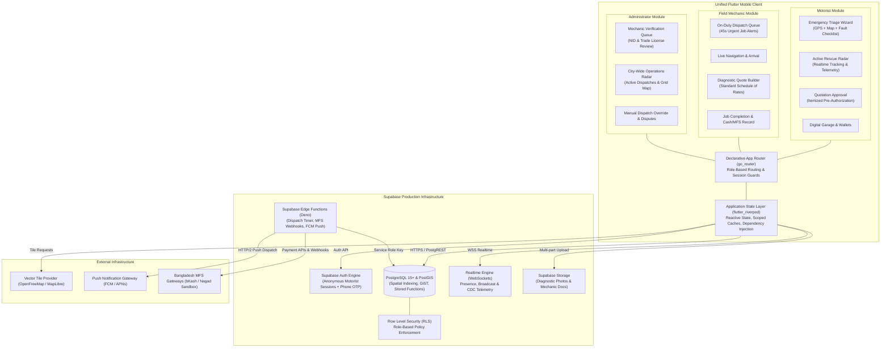
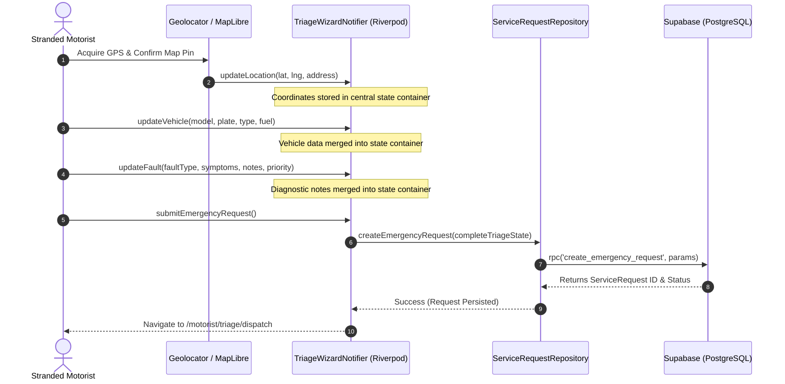

# ROADIX — System Architecture Specification

**Status:** APPROVED DESIGN BASELINE (Phase 2 Deliverable)  
**Architecture Style:** Layered Feature-First Mobile Client + Supabase Backend  
**Target Platform:** Unified Flutter Codebase (iOS & Android)  

---

## 1. System Context & Top-Level Architecture

ROADIX is structured as a **unified mobile client application** communicating with a **managed Supabase backend** and supporting external services.



---

## 2. Flutter Client Layered Architecture (Feature-First)

To prevent the monolithic view anti-pattern identified in Phase 1 (e.g. 867-line `emergency_home_screen.dart`), the application is organized using **Feature-First Layered Architecture**:

```text
lib/
├── main.dart                          # App bootstrapping, environment loading, top-level observers
├── src/
│   ├── app.dart                       # MaterialApp.router configuration, global theme
│   ├── core/                          # Cross-cutting foundational utilities
│   │   ├── constants/                 # App constants, design tokens, rate schedules
│   │   ├── errors/                    # Failure classes, typed exceptions, error reporting
│   │   ├── network/                   # Supabase client wrapper, connectivity listener
│   │   ├── router/                    # go_router configuration, role-based redirect guards
│   │   ├── storage/                   # Local secure cache (credentials, offline state)
│   │   ├── theme/                     # Showroom Porcelain & Caliper Crimson design system
│   │   └── utils/                     # Formatting, coordinate calculations, validators
│   └── features/                      # Modular, self-contained business capabilities
│       ├── authentication/            # Anonymous auth, Phone OTP, session binding
│       ├── emergency_triage/          # Breakdown reporting, GPS pin, vehicle selector
│       ├── dispatch/                  # Matching engine, radar animation, offer timer
│       ├── tracking/                  # Live mechanic GPS telemetry, ETA calculation
│       ├── quotations/                # Itemized quote builder, customer approval
│       ├── payments/                  # bKash/Nagad integration, cash recording, receipts
│       ├── digital_garage/            # Motorist vehicle CRUD
│       ├── emergency_contacts/        # Motorist broadcast contacts CRUD
│       ├── mechanic_operations/       # On-duty queue, job acceptance, arrival toggle
│       └── admin_console/             # Verification queue, city operations radar
```

### 2.1 The Four Architectural Layers

Every feature module contains up to four distinct layers:

1. **Domain Layer (Pure Dart):**
   - **Entities:** Immutable domain models (`ServiceRequest`, `MechanicProfile`, `Quotation`, `Vehicle`).
   - **Value Objects:** Strongly-typed wrappers (`DhakaCoordinates`, `BangladeshPhone`, `LicensePlate`).
   - **Failures:** Domain-specific failure declarations (`DispatchTimeoutFailure`, `QuoteRejectedFailure`).
   - **Dependencies:** Completely pure Dart; zero imports from Flutter or external packages.

2. **Data Layer:**
   - **DTOs (Data Transfer Objects):** Serialization and deserialization (`toJson`, `fromJson`) mapping PostgREST responses to Domain Entities.
   - **Data Sources:** Direct Supabase PostgREST clients and local cache data sources.
   - **Repository Implementations:** Implementations of domain repository interfaces; handles caching and offline fallback.

3. **Application Layer:**
   - **State Notifiers / Controllers:** Business logic orchestrators managed by Riverpod (`AsyncNotifier`).
   - **Service Coordinators:** Location tracking stream listeners, network connectivity listeners.

4. **Presentation Layer:**
   - **Screens:** Scaffold-level views that observe application state.
   - **Widgets:** Reusable, small-footprint atomic UI components (< 150 lines per widget).
   - **Theme & Formatting:** UI presentation helpers.

---

## 3. Client State Management Architecture: Riverpod

### Decision Justification:
Phase 1 revealed that while `flutter_bloc` was declared in `pubspec.yaml`, it was never imported or used. For ROADIX, **`flutter_riverpod` (v2.6+)** is selected over BLoC for the following architectural reasons:
1. **Compile-Time Safety & Zero Code-Gen Overhead:** Unifies state management and dependency injection without requiring separate `get_it` service locators.
2. **First-Class Async Data Modeling:** Native `AsyncValue` handles `loading`, `error`, and `data` states effortlessly, eliminating boilerplate state classes.
3. **Auto-Disposal & Memory Management:** Location streams, Realtime channels, and countdown timers automatically dispose when screens unmount.
4. **Scoped Context Independence:** Providers can be read and invalidated inside repositories, background isolates, or router redirect guards without `BuildContext`.

---

## 4. Navigation Architecture: Declarative `go_router`

### Route Hierarchy and Role-Based Guards

```mermaid
flowchart TD
    Start([App Launch / Splash]) --> CheckAuth{Auth & Role Check}

    CheckAuth -->|No Session / Unregistered| AnonPrompt[Create Anonymous Session]
    AnonPrompt --> MotoristFlow[/motorist/home]

    CheckAuth -->|Authenticated Motorist| MotoristFlow
    CheckAuth -->|Authenticated Mechanic - Pending| MechPending[/mechanic/pending-approval]
    CheckAuth -->|Authenticated Mechanic - Verified| MechFlow[/mechanic/dashboard]
    CheckAuth -->|Authenticated Administrator| AdminFlow[/admin/radar]

    subgraph MotoristRoutes["Motorist Route Group"]
        MotoristFlow --> Wizard1[/motorist/triage/location]
        Wizard1 --> Wizard2[/motorist/triage/vehicle]
        Wizard2 --> Wizard3[/motorist/triage/fault]
        Wizard3 --> Wizard4[/motorist/triage/dispatch]
        Wizard4 --> Tracking[/motorist/tracking/:id]
        Tracking --> Invoice[/motorist/invoice/:id]
    end

    subgraph MechanicRoutes["Mechanic Route Group"]
        MechFlow --> OfferModal[/mechanic/offer/:id]
        OfferModal --> ActiveJob[/mechanic/active-job/:id]
        ActiveJob --> BuildQuote[/mechanic/quote/:id]
        BuildQuote --> JobComplete[/mechanic/complete/:id]
    end
```

### Route Guard Rules:
- **Emergency Unauthenticated Pass:** Unregistered motorists are automatically provisioned with a Supabase Anonymous Auth session (`is_anonymous: true`), granting immediate access to `/motorist/triage/location`.
- **Mechanic Enclosure:** Mechanics cannot access `/motorist/*` or `/admin/*`. Unverified mechanics are trapped on `/mechanic/pending-approval` until an administrator approves their NID and trade license.
- **Admin Enclosure:** `/admin/*` requires a signed JWT containing the custom claim `user_role: 'admin'`.

---

## 5. Client Data Flow & State Preservation

To solve the **critical data-loss bugs** documented in Phase 1 (dropped GPS coordinates and dropped triage notes):


*Zero parameters are passed via widget constructor arguments; all wizard data is stored in the `TriageWizardNotifier` and persisted atomically to the backend.*
