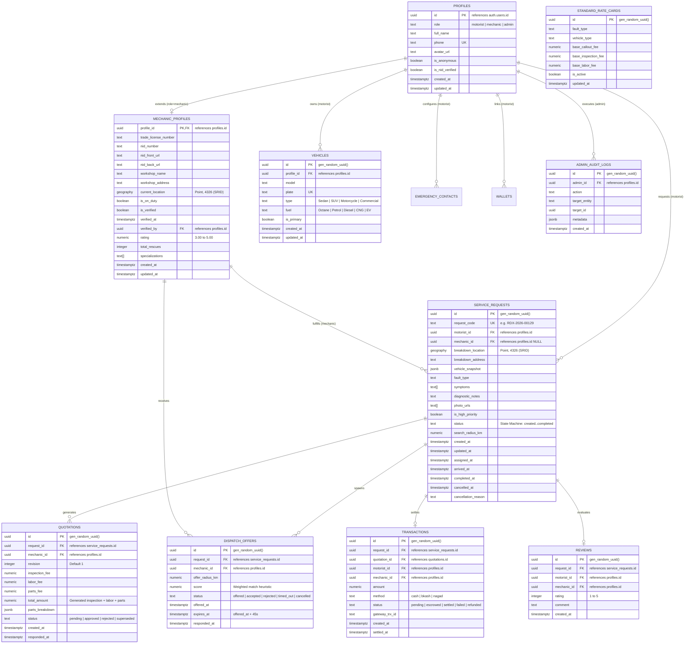

# ROADIX — Database Design & Schema Specification

**Status:** APPROVED DESIGN BASELINE (Phase 2 Deliverable)  
**Database Engine:** PostgreSQL 15+ (Supabase)  
**Extensions:** `postgis` (v3.3+), `uuid-ossp`, `pgcrypto`  

---

## 1. Entity-Relationship Diagram (ERD)



---

## 2. Table Definitions, Constraints & DDL

### 2.1 Profiles Table (`profiles`)
Linked 1:1 with `auth.users`. Supports anonymous motorist accounts.
```sql
CREATE TABLE public.profiles (
    id UUID PRIMARY KEY REFERENCES auth.users(id) ON DELETE CASCADE,
    role TEXT NOT NULL DEFAULT 'motorist' CHECK (role IN ('motorist', 'mechanic', 'admin')),
    full_name TEXT NOT NULL,
    phone TEXT UNIQUE,
    avatar_url TEXT,
    is_anonymous BOOLEAN NOT NULL DEFAULT FALSE,
    is_nid_verified BOOLEAN NOT NULL DEFAULT FALSE,
    created_at TIMESTAMPTZ NOT NULL DEFAULT timezone('utc'::text, now()),
    updated_at TIMESTAMPTZ NOT NULL DEFAULT timezone('utc'::text, now())
);
CREATE INDEX idx_profiles_role ON public.profiles(role);
CREATE INDEX idx_profiles_phone ON public.profiles(phone);
```

### 2.2 Mechanic Profiles Table (`mechanic_profiles`)
Stores specialized credentials and real-time geographic telemetry for dispatch.
```sql
CREATE TABLE public.mechanic_profiles (
    profile_id UUID PRIMARY KEY REFERENCES public.profiles(id) ON DELETE CASCADE,
    trade_license_number TEXT,
    nid_number TEXT,
    nid_front_url TEXT,
    nid_back_url TEXT,
    workshop_name TEXT NOT NULL,
    workshop_address TEXT NOT NULL,
    current_location GEOGRAPHY(Point, 4326),
    is_on_duty BOOLEAN NOT NULL DEFAULT FALSE,
    is_verified BOOLEAN NOT NULL DEFAULT FALSE,
    verified_at TIMESTAMPTZ,
    verified_by UUID REFERENCES public.profiles(id),
    rating NUMERIC(3, 2) NOT NULL DEFAULT 5.00 CHECK (rating >= 1.00 AND rating <= 5.00),
    total_rescues INTEGER NOT NULL DEFAULT 0 CHECK (total_rescues >= 0),
    specializations TEXT[] NOT NULL DEFAULT '{}',
    created_at TIMESTAMPTZ NOT NULL DEFAULT timezone('utc'::text, now()),
    updated_at TIMESTAMPTZ NOT NULL DEFAULT timezone('utc'::text, now())
);
-- GiST Spatial Index for sub-millisecond distance queries
CREATE INDEX idx_mechanics_location ON public.mechanic_profiles USING GIST(current_location);
CREATE INDEX idx_mechanics_duty_verified ON public.mechanic_profiles(is_on_duty, is_verified);
```

### 2.3 Service Requests Table (`service_requests`)
The central entity representing an active emergency assistance lifecycle.
```sql
CREATE TABLE public.service_requests (
    id UUID PRIMARY KEY DEFAULT gen_random_uuid(),
    request_code TEXT UNIQUE NOT NULL,
    motorist_id UUID NOT NULL REFERENCES public.profiles(id) ON DELETE RESTRICT,
    mechanic_id UUID REFERENCES public.profiles(id) ON DELETE RESTRICT,
    breakdown_location GEOGRAPHY(Point, 4326) NOT NULL,
    breakdown_address TEXT NOT NULL,
    vehicle_snapshot JSONB NOT NULL,
    fault_type TEXT NOT NULL,
    symptoms TEXT[] NOT NULL DEFAULT '{}',
    diagnostic_notes TEXT,
    photo_urls TEXT[] NOT NULL DEFAULT '{}',
    is_high_priority BOOLEAN NOT NULL DEFAULT FALSE,
    status TEXT NOT NULL DEFAULT 'created' CHECK (
        status IN (
            'created',
            'searching',
            'assigned',
            'en_route',
            'arrived',
            'diagnosing',
            'quote_pending',
            'servicing',
            'completed',
            'cancelled'
        )
    ),
    search_radius_km NUMERIC(4, 2) NOT NULL DEFAULT 5.00,
    created_at TIMESTAMPTZ NOT NULL DEFAULT timezone('utc'::text, now()),
    updated_at TIMESTAMPTZ NOT NULL DEFAULT timezone('utc'::text, now()),
    assigned_at TIMESTAMPTZ,
    arrived_at TIMESTAMPTZ,
    completed_at TIMESTAMPTZ,
    cancelled_at TIMESTAMPTZ,
    cancellation_reason TEXT
);
CREATE INDEX idx_service_requests_motorist ON public.service_requests(motorist_id);
CREATE INDEX idx_service_requests_mechanic ON public.service_requests(mechanic_id);
CREATE INDEX idx_service_requests_status ON public.service_requests(status);
CREATE INDEX idx_service_requests_location ON public.service_requests USING GIST(breakdown_location);
```

### 2.4 Dispatch Offers Table (`dispatch_offers`)
Stores ephemeral candidate offers with a strict 45-second deadline to prevent race conditions.
```sql
CREATE TABLE public.dispatch_offers (
    id UUID PRIMARY KEY DEFAULT gen_random_uuid(),
    request_id UUID NOT NULL REFERENCES public.service_requests(id) ON DELETE CASCADE,
    mechanic_id UUID NOT NULL REFERENCES public.profiles(id) ON DELETE CASCADE,
    offer_radius_km NUMERIC(4, 2) NOT NULL,
    score NUMERIC(5, 2) NOT NULL,
    status TEXT NOT NULL DEFAULT 'offered' CHECK (
        status IN ('offered', 'accepted', 'rejected', 'timed_out', 'cancelled')
    ),
    offered_at TIMESTAMPTZ NOT NULL DEFAULT timezone('utc'::text, now()),
    expires_at TIMESTAMPTZ NOT NULL DEFAULT (timezone('utc'::text, now()) + INTERVAL '45 seconds'),
    responded_at TIMESTAMPTZ,
    CONSTRAINT uq_request_mechanic_offer UNIQUE (request_id, mechanic_id, offered_at)
);
CREATE INDEX idx_dispatch_offers_request ON public.dispatch_offers(request_id);
CREATE INDEX idx_dispatch_offers_mechanic_status ON public.dispatch_offers(mechanic_id, status);
CREATE INDEX idx_dispatch_offers_expires ON public.dispatch_offers(expires_at) WHERE status = 'offered';
```

### 2.5 Quotations Table (`quotations`)
Stores itemized pre-service estimates that require explicit motorist pre-authorization.
```sql
CREATE TABLE public.quotations (
    id UUID PRIMARY KEY DEFAULT gen_random_uuid(),
    request_id UUID NOT NULL REFERENCES public.service_requests(id) ON DELETE CASCADE,
    mechanic_id UUID NOT NULL REFERENCES public.profiles(id) ON DELETE RESTRICT,
    revision INTEGER NOT NULL DEFAULT 1,
    inspection_fee NUMERIC(10, 2) NOT NULL CHECK (inspection_fee >= 0),
    labor_fee NUMERIC(10, 2) NOT NULL CHECK (labor_fee >= 0),
    parts_fee NUMERIC(10, 2) NOT NULL DEFAULT 0.00 CHECK (parts_fee >= 0),
    total_amount NUMERIC(10, 2) GENERATED ALWAYS AS (inspection_fee + labor_fee + parts_fee) STORED,
    parts_breakdown JSONB NOT NULL DEFAULT '[]'::jsonb,
    status TEXT NOT NULL DEFAULT 'pending' CHECK (
        status IN ('pending', 'approved', 'rejected', 'superseded')
    ),
    created_at TIMESTAMPTZ NOT NULL DEFAULT timezone('utc'::text, now()),
    responded_at TIMESTAMPTZ,
    CONSTRAINT uq_request_revision UNIQUE (request_id, revision)
);
CREATE INDEX idx_quotations_request ON public.quotations(request_id);
```

### 2.6 Digital Garage & Wallets Tables
```sql
CREATE TABLE public.vehicles (
    id UUID PRIMARY KEY DEFAULT gen_random_uuid(),
    profile_id UUID NOT NULL REFERENCES public.profiles(id) ON DELETE CASCADE,
    model TEXT NOT NULL,
    plate TEXT NOT NULL,
    type TEXT NOT NULL CHECK (type IN ('Sedan', 'SUV', 'Motorcycle', 'Commercial')),
    fuel TEXT NOT NULL CHECK (fuel IN ('Octane', 'Petrol', 'Diesel', 'CNG', 'EV')),
    is_primary BOOLEAN NOT NULL DEFAULT FALSE,
    created_at TIMESTAMPTZ NOT NULL DEFAULT timezone('utc'::text, now()),
    updated_at TIMESTAMPTZ NOT NULL DEFAULT timezone('utc'::text, now())
);
CREATE INDEX idx_vehicles_profile ON public.vehicles(profile_id);

CREATE TABLE public.wallets (
    id UUID PRIMARY KEY DEFAULT gen_random_uuid(),
    profile_id UUID NOT NULL REFERENCES public.profiles(id) ON DELETE CASCADE,
    provider TEXT NOT NULL CHECK (provider IN ('bKash', 'Nagad', 'Rocket')),
    account_number TEXT NOT NULL,
    is_primary BOOLEAN NOT NULL DEFAULT FALSE,
    created_at TIMESTAMPTZ NOT NULL DEFAULT timezone('utc'::text, now())
);
CREATE INDEX idx_wallets_profile ON public.wallets(profile_id);
```

---

## 3. PostGIS Discovery Stored Function

This function executes the radial discovery of available mechanics within a defined radius in meters:
```sql
CREATE OR REPLACE FUNCTION public.find_eligible_mechanics(
    p_breakdown_location GEOGRAPHY,
    p_radius_meters DOUBLE PRECISION,
    p_fault_type TEXT
)
RETURNS TABLE (
    mechanic_id UUID,
    distance_meters DOUBLE PRECISION,
    rating NUMERIC,
    total_rescues INTEGER,
    specializations TEXT[]
)
LANGUAGE sql
STABLE
AS $$
    SELECT 
        m.profile_id AS mechanic_id,
        ST_Distance(m.current_location, p_breakdown_location) AS distance_meters,
        m.rating,
        m.total_rescues,
        m.specializations
    FROM public.mechanic_profiles m
    WHERE m.is_on_duty = TRUE
      AND m.is_verified = TRUE
      AND m.current_location IS NOT NULL
      AND ST_DWithin(m.current_location, p_breakdown_location, p_radius_meters)
    ORDER BY distance_meters ASC;
$$;
```
