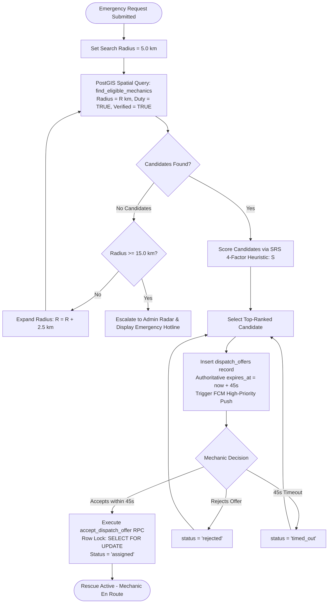

# ROADIX — Automated Dispatch Engine Specification

**Status:** APPROVED DESIGN BASELINE (Phase 2 Deliverable)  
**SRS Reference:** Section 4: Location-Aware Dispatch & Mechanic Assignment Engine  

---

## 1. Dispatch Architecture & Expansion Flow

ROADIX implements an automated radial expansion and candidate ranking engine designed for Dhaka's dense urban road topography:

---

## 2. Weighted Candidate Ranking Algorithm (SRS Specification)

For every candidate mechanic discovered within the radial envelope, a composite suitability score $S \in [0, 100]$ is computed:

$$S = (0.40 \times P) + (0.25 \times E) + (0.15 \times T) + (0.20 \times A)$$

### 2.1 Component Definitions & Normalization Formulas

#### 1. Proximity Score ($P \in [0, 100]$ — 40% Weight)
Measures physical distance from the stranded vehicle. Proximity decreases linearly to zero at the current search radius boundary $R_{\text{max}}$:
$$P = \max\left(0, \left(1 - \frac{d}{R_{\text{max}}}\right) \times 100\right)$$
*where $d$ is the geodesic distance in kilometers computed via PostGIS `ST_Distance`.*

#### 2. Specialization Match ($E \in [0, 100]$ — 25% Weight)
Evaluates whether the technician possesses verified skills matching the reported breakdown:
$$E = \begin{cases} 
100 & \text{if reported fault type } \in \text{mechanic.specializations} \\
50 & \text{if mechanic holds 'General Automotive Breakdown'} \\
10 & \text{otherwise (fallback technician)}
\end{cases}$$

#### 3. Trust & Rating ($T \in [0, 100]$ — 15% Weight)
Transforms the mechanic's 5-star customer rating into a normalized score:
$$T = \left(\frac{\text{rating} - 1.00}{4.00}\right) \times 100$$
*(For new technicians with $< 5$ rescues, rating is smoothed to a baseline $4.50$ ($T = 87.5$)).*

#### 4. Availability & Historical Performance ($A \in [0, 100]$ — 20% Weight)
Rewards mechanics with high historical acceptance rates and fast response times:
$$A = (\text{acceptance\_rate} \times 70) + (\text{completion\_rate} \times 30)$$

---

## 3. Concurrency Safety & Anti-Collision Protocols

1. **Strict 1:1 Sequential Offers:** The engine never offers a single breakdown request to multiple mechanics simultaneously. Broadcasting to all nearby mechanics causes race conditions and driver cancellation confusion.
2. **Authoritative Server Deadline:** The 45-second acceptance window is enforced by the database clock (`now() <= expires_at`). A client cannot fake an on-time acceptance by adjusting its mobile system clock.
3. **Pessimistic Row Locking:** During acceptance, PostgreSQL executes `FOR UPDATE` on both the `dispatch_offers` row and the `service_requests` row. If another process altered the status, the transaction rolls back cleanly with a descriptive exception.
4. **Automatic Offer Invalidation:** As soon as an offer is accepted, any remaining offers for that request are immediately set to `cancelled`.
