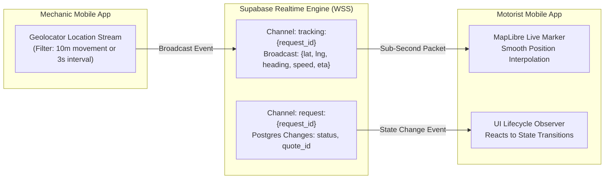

# ROADIX — Realtime Telemetry, Lifecycle State Machine & Notifications

**Status:** APPROVED DESIGN BASELINE (Phase 2 Deliverable)  
**SRS Reference:** Section 3: Emergency Lifecycles & Realtime Communication  

---

## 1. Authoritative Emergency Service Request State Machine

The entire roadside assistance lifecycle is governed by a strict, finite state machine enforced by PostgreSQL CHECK constraints and stored procedures:

```mermaid
stateDiagram-v2
    [*] --> created: Motorist initializes triage wizard
    created --> searching: Motorist submits complete triage
    
    searching --> assigned: Mechanic accepts 45s offer
    searching --> cancelled: Motorist cancels before match
    
    assigned --> en_route: Mechanic departs workshop
    assigned --> cancelled: Cancellation with fee rules
    
    en_route --> arrived: Mechanic reaches vehicle coordinates
    arrived --> diagnosing: On-site inspection commences
    
    diagnosing --> quote_pending: Mechanic submits diagnostic quote
    
    quote_pending --> servicing: Motorist APPROVES quotation
    quote_pending --> diagnosing: Motorist REJECTS; Mechanic revises quote
    quote_pending --> cancelled: Motorist declines repair (Pays inspection fee)
    
    servicing --> completed: Mechanic finishes repair & confirms payment
    cancelled --> [*]
    completed --> [*]
```



### 1.1 State Transition Matrix

| Current State | Target State | Authorized Actor | Triggering Action / Validation Rule |
| :--- | :--- | :--- | :--- |
| `created` | `searching` | Motorist | All triage inputs (GPS coordinates, vehicle, fault category) submitted. |
| `searching` | `assigned` | System / Mechanic | Mechanic executes `accept_dispatch_offer` before 45-second deadline. |
| `searching` | `cancelled` | Motorist | Cancel button tapped while radar is scanning. Zero fee incurred. |
| `assigned` | `en_route` | Mechanic | Technician confirms departure on field app. Realtime GPS stream begins. |
| `en_route` | `arrived` | Mechanic / Geo | Proximity check: technician within 100 meters of breakdown coordinate. |
| `arrived` | `diagnosing` | Mechanic | Technician starts physical diagnosis and electrical/mechanical scan. |
| `diagnosing` | `quote_pending` | Mechanic | Submits itemized quote (Inspection + Labor + Parts) via standard rate card. |
| `quote_pending`| `servicing` | Motorist | Motorist reviews quote and taps "Approve Estimate". Work officially authorized. |
| `quote_pending`| `diagnosing` | Motorist | Motorist taps "Request Revision"; mechanic amends parts/labor breakdown. |
| `servicing` | `completed` | Mechanic | Repair finished, test run complete, payment recorded (Cash / MFS). |
| `assigned` | `cancelled` | Motorist / Admin | Cancellation after assignment (subject to standard callout cancellation fee). |

---

## 2. Realtime Telemetry & Supabase Channel Topology



### 2.1 Battery & Bandwidth Optimization Protocol
- **Location Sampling Filter:** `geolocator` is configured with a distance filter of 10 meters and a minimum time interval of 3 seconds. Coordinates are NOT emitted if the vehicle is stationary in traffic.
- **Payload Compression:** Telemetry packets are sent as compact JSON arrays `[lat, lng, heading, speed_kmh, timestamp]` rather than bloated objects, minimizing cellular data overhead on Bangladesh 3G/4G networks.
- **Client-Side Smooth Interpolation:** The motorist app utilizes a linear interpolation curve (`Tween<LatLng>`) to smoothly animate the mechanic van icon between GPS updates without visual stutter.

---

## 3. Dual-Channel Notification Architecture (FCM & APNs)

Because background WebSockets are routinely terminated by Android battery optimizations and iOS thermal throttling, all mission-critical events use **Firebase Cloud Messaging (FCM)** and **Apple Push Notification Service (APNs)**:

```text
┌────────────────────────────────────────────────────────────────────────┐
│ High-Priority Push Alert (FCM v1 / APNs Priority 10)                  │
│ Payload:                                                               │
│ {                                                                      │
│   "category": "DISPATCH_OFFER",                                        │
│   "request_id": "9b1deb4d-3b7d-4bad-9bdd-2b0d7b3dcb6d",                │
│   "fault": "Dead Battery Jumpstart",                                   │
│   "distance": "1.8 km",                                                │
│   "expires_at": "2026-11-17T17:45:00Z"                                 │
│ }                                                                      │
│ • Plays continuous emergency alert sound for 45 seconds                │
│ • Bypasses Do-Not-Disturb on Android via Critical Notification Channel │
└────────────────────────────────────────────────────────────────────────┘
```

### 3.1 Network Disconnection Recovery Protocol
If cellular connectivity drops during an active rescue:
1. **Local State Journal:** The mobile client saves all state transitions to local persistent storage (`shared_preferences` / encrypted secure storage).
2. **Exponential Backoff Reconnect:** Upon network restoration, client triggers a synchronization ping:
   `GET /rest/v1/service_requests?id=eq.{id}&select=*`
3. **Optimistic Locking:** If client local status lags behind the server, the server's authoritative state machine always overrides the local client.
