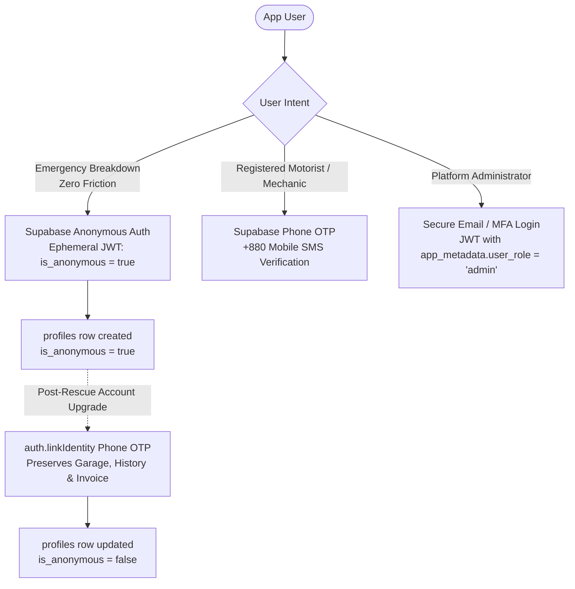

# ROADIX — Security Model & Authorization Policy

**Status:** APPROVED DESIGN BASELINE (Phase 2 Deliverable)  
**Standard:** Zero-Trust Client, Defense-in-Depth, Strict PostgreSQL Row Level Security (RLS)  

---

## 1. Authentication & Identity Architecture

ROADIX supports three distinct authentication pathways:



### 1.1 Anonymous Motorist Sessions (Frictionless Emergency Access)
- **Requirement:** A driver stranded on a dark highway must not be blocked by a login screen, email verification, or password setup.
- **Implementation:** App calls `supabase.auth.signInAnonymously()`. Supabase creates a record in `auth.users` with `is_anonymous: true`.
- **Session Continuity:** The client retains this session in secure device storage (`flutter_secure_storage`). All subsequent emergency request tables link to `auth.uid()`.
- **Account Linking:** After emergency resolution, the motorist can enter their phone number. `supabase.auth.linkIdentity()` merges the phone credential into the existing user UUID, preserving all past breakdown history and vehicle data.

### 1.2 Field Mechanic Authentication & Vetting
- **Requirement:** Field mechanics operate with commercial trust and enter motorists' physical locations; they cannot be anonymous.
- **Implementation:** Mandatory Bangladeshi phone number verification (`+880 1XXXXXXXXX`) via Supabase Auth OTP.
- **Vetting Gate:** Account starts with `is_verified = false`. Mechanics cannot enter the on-duty dispatch queue or receive dispatch offers until an Administrator verifies their National ID (NID) and workshop trade license.

### 1.3 Administrator Privilege Separation
- **Implementation:** Admin users are flagged inside `auth.users.raw_app_meta_data -> { "user_role": "admin" }`.
- **Immutability:** Client applications **cannot modify** `raw_app_meta_data`. Role changes can only be performed by direct database administrators or trusted Supabase Edge Functions with the `service_role` key.

---

## 2. Row Level Security (RLS) Policy Specifications

RLS is enabled on **100% of public database tables**. Below are the exact production SQL policy rules:

### 2.1 Profiles Table
```sql
ALTER TABLE public.profiles ENABLE ROW LEVEL SECURITY;

-- Anyone authenticated can read basic profiles (needed for technician/motorist display)
CREATE POLICY "profiles_select_authenticated" ON public.profiles
    FOR SELECT TO authenticated
    USING (TRUE);

-- Users can only modify their own profile
CREATE POLICY "profiles_update_own" ON public.profiles
    FOR UPDATE TO authenticated
    USING (auth.uid() = id)
    WITH CHECK (auth.uid() = id);
```

### 2.2 Mechanic Profiles Table
```sql
ALTER TABLE public.mechanic_profiles ENABLE ROW LEVEL SECURITY;

-- Anyone authenticated can view verified mechanics (for search and active radar)
CREATE POLICY "mechanics_select_verified" ON public.mechanic_profiles
    FOR SELECT TO authenticated
    USING (is_verified = TRUE OR auth.uid() = profile_id);

-- Mechanics can only update their own duty status and location
CREATE POLICY "mechanics_update_own" ON public.mechanic_profiles
    FOR UPDATE TO authenticated
    USING (auth.uid() = profile_id)
    WITH CHECK (auth.uid() = profile_id);
```

### 2.3 Vehicles, Wallets & Emergency Contacts
```sql
ALTER TABLE public.vehicles ENABLE ROW LEVEL SECURITY;
ALTER TABLE public.wallets ENABLE ROW LEVEL SECURITY;
ALTER TABLE public.emergency_contacts ENABLE ROW LEVEL SECURITY;

-- Strict motorist data isolation: Only owner can access their garage, contacts, and wallets
CREATE POLICY "vehicles_all_owner" ON public.vehicles
    FOR ALL TO authenticated
    USING (auth.uid() = profile_id)
    WITH CHECK (auth.uid() = profile_id);

CREATE POLICY "wallets_all_owner" ON public.wallets
    FOR ALL TO authenticated
    USING (auth.uid() = profile_id)
    WITH CHECK (auth.uid() = profile_id);

CREATE POLICY "contacts_all_owner" ON public.emergency_contacts
    FOR ALL TO authenticated
    USING (auth.uid() = profile_id)
    WITH CHECK (auth.uid() = profile_id);
```

### 2.4 Service Requests Table
```sql
ALTER TABLE public.service_requests ENABLE ROW LEVEL SECURITY;

-- Motorists read their own requests; assigned mechanics read their active jobs; admins read all
CREATE POLICY "requests_select_participants" ON public.service_requests
    FOR SELECT TO authenticated
    USING (
        auth.uid() = motorist_id 
        OR auth.uid() = mechanic_id 
        OR ((auth.jwt() -> 'app_metadata' ->> 'user_role') = 'admin')
    );

-- Motorists can insert their own request
CREATE POLICY "requests_insert_motorist" ON public.service_requests
    FOR INSERT TO authenticated
    WITH CHECK (auth.uid() = motorist_id);

-- Status updates are restricted: Motorists can only cancel; mechanics can only advance job
CREATE POLICY "requests_update_participants" ON public.service_requests
    FOR UPDATE TO authenticated
    USING (
        auth.uid() = motorist_id 
        OR auth.uid() = mechanic_id
        OR ((auth.jwt() -> 'app_metadata' ->> 'user_role') = 'admin')
    );
```

### 2.5 Dispatch Offers Table
```sql
ALTER TABLE public.dispatch_offers ENABLE ROW LEVEL SECURITY;

-- Mechanics can only view offers specifically addressed to them
CREATE POLICY "offers_select_mechanic" ON public.dispatch_offers
    FOR SELECT TO authenticated
    USING (auth.uid() = mechanic_id);

-- Mechanics can only update their own offer status (accept/reject) before expires_at
CREATE POLICY "offers_update_mechanic" ON public.dispatch_offers
    FOR UPDATE TO authenticated
    USING (auth.uid() = mechanic_id AND now() <= expires_at)
    WITH CHECK (auth.uid() = mechanic_id);
```

### 2.6 Quotations Table
```sql
ALTER TABLE public.quotations ENABLE ROW LEVEL SECURITY;

-- Motorist and Assigned Mechanic can view the quotation
CREATE POLICY "quotations_select_participants" ON public.quotations
    FOR SELECT TO authenticated
    USING (
        auth.uid() = mechanic_id 
        OR auth.uid() IN (SELECT motorist_id FROM public.service_requests WHERE id = request_id)
    );

-- Only assigned mechanic can submit/revise quotes
CREATE POLICY "quotations_insert_mechanic" ON public.quotations
    FOR INSERT TO authenticated
    WITH CHECK (auth.uid() = mechanic_id);

-- Motorist can update status (approve/reject)
CREATE POLICY "quotations_update_motorist" ON public.quotations
    FOR UPDATE TO authenticated
    USING (auth.uid() IN (SELECT motorist_id FROM public.service_requests WHERE id = request_id))
    WITH CHECK (auth.uid() IN (SELECT motorist_id FROM public.service_requests WHERE id = request_id));
```

---

## 3. Storage Security Policies

Supabase Storage buckets are isolated with granular object policies:

1. **`diagnostic_photos` (Bucket: public reads, restricted write):**
   - Upload permitted only by authenticated users during request creation: `(bucket_id = 'diagnostic_photos' AND auth.uid()::text = (storage.foldername(name))[1])`.
2. **`mechanic_documents` (Bucket: private):**
   - Upload permitted only by the submitting mechanic: `auth.uid()::text = (storage.foldername(name))[1]`.
   - Read permitted strictly to the submitting mechanic and users with `app_metadata.user_role = 'admin'`.

---

## 4. Secret Management & Compilation Injection

To resolve **Defect 6** from Phase 1 (hardcoded keys in `main.dart`):
1. **Zero Committed Secrets:** All secrets, project URLs, and map tile URLs are stored in local `.env` files (ignored by Git) and templated in `.env.example`.
2. **Compile-Time Injection:** Flutter builds use `--dart-define-from-file=.env`. In code, values are read via `const String.fromEnvironment('SUPABASE_URL')`.
3. **No Service-Role Key in Client:** The Supabase `service_role` secret is never bundled into mobile binaries. It exists exclusively within the Supabase Edge Functions environment.
