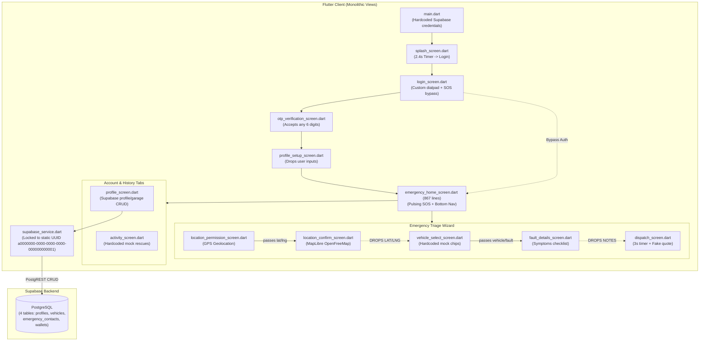

# Phase 01 — Complete Existing Project Audit and Baseline Verification

**Phase Status:** COMPLETED (Awaiting Approval to proceed to Phase 2)  
**Executed Date:** November 17, 2026  
**Auditor:** Lead Software Architect & Technical Auditor  
**Primary References:** Roadix SRS, System Analysis, ROADIX_AUDIT_REPORT.md, lib/ (26 Dart files)  

---

## 1. Executive Summary & Baseline Findings

During Phase 1, a comprehensive line-by-line inspection of all 26 Dart files under `lib/`, native configurations (`android/`, `ios/`), dependencies (`pubspec.yaml`), and tests was completed.

### Key Conclusions:
1. **Current State:** The mobile application is an **early-stage UI prototype / Proof of Concept (PoC)**. While the user interface exhibits high visual polish adhering to the "Showroom Porcelain" / "Caliper Crimson" design system, **the emergency assistance operational lifecycle is 100% simulated**.
2. **Broken Data Flow:** Critical data acquired in earlier screens (GPS coordinates in Step 1, user diagnostic notes in Step 3) is **completely dropped** during screen transitions and never reaches the dispatch screen or the backend.
3. **Shared Static Identity:** While CRUD operations for profiles, vehicles, and emergency contacts are wired to Supabase PostgREST, they target a **single hardcoded static UUID** (`a0000000-0000-0000-0000-000000000001`). There is zero user isolation or session binding.
4. **Architectural Void & Dependency Ghosting:** The project declares heavy architecture packages (`flutter_bloc`, `get_it`, `drift`, `dio`, `equatable`, `sqlite3_flutter_libs`, `path_provider`, `latlong2`), but **none of them are imported or used anywhere**. The app relies entirely on local `setState()` inside oversized monolithic widgets.
5. **Missing Roles:** The codebase only contains motorist-facing screens. The **Field Mechanic** role and **Platform Administrator** role specified in the SRS are **0% implemented** (no screens, no services, no logic).
6. **Platform Defect:** `ios/Runner/Info.plist` completely lacks `NSLocationWhenInUseUsageDescription`, guaranteeing an immediate crash on iOS devices.

---

## 2. Feature Implementation Matrix (SRS vs Existing Codebase)

| SRS Functional Area | Existing Component | Status | File Reference | Technical Finding & Source Evidence |
| :--- | :--- | :--- | :--- | :--- |
| **Phone Authentication** | `LoginScreen` | **SIMULATED** | [`lib/screens/login_screen.dart:L46-L54`](file:///c:/Users/aahad/ROADIX-Mobile/lib/screens/login_screen.dart#L46-L54) | Custom keypad collects digits, but `_proceedToOtp` does not call Supabase Auth. Has a "Skip to SOS" button that allows completely bypassing login. |
| **SMS OTP Verification** | `OtpVerificationScreen`| **SIMULATED** | [`lib/screens/otp_verification_screen.dart:L59-L67`](file:///c:/Users/aahad/ROADIX-Mobile/lib/screens/otp_verification_screen.dart#L59-L67) | Any 6-digit number passes verification (`if (_enteredOtp.length == 6)`). No verification code is verified with Supabase Auth or SMS gateway. |
| **Profile Onboarding** | `ProfileSetupScreen` | **SIMULATED** | [`lib/screens/profile_setup_screen.dart#L36-L41`](file:///c:/Users/aahad/ROADIX-Mobile/lib/screens/profile_setup_screen.dart#L36-L41) | UI collects name, vehicle, and fuel type, but `_finishSetup` navigates straight to `EmergencyHomeScreen` without saving anything to Supabase. |
| **GPS Acquisition** | `LocationPermissionScreen` | **IMPLEMENTED** | [`lib/screens/location_permission_screen.dart:L18-L83`](file:///c:/Users/aahad/ROADIX-Mobile/lib/screens/location_permission_screen.dart#L18-L83) | Genuinely requests device location permission using `geolocator` and fetches live GPS position; has graceful fallback to Dhaka center if timed out. |
| **Map Pin Confirmation** | `LocationConfirmScreen` | **PARTIALLY IMPLEMENTED** | [`lib/screens/location_confirm_screen.dart:L25-L35`](file:///c:/Users/aahad/ROADIX-Mobile/lib/screens/location_confirm_screen.dart#L25-L35) | Renders OpenFreeMap vector tiles on MapLibre GL. **Broken Data Flow:** Confirmation button drops `initialLat`/`initialLng` when routing to `VehicleSelectScreen` (Line 405-412). |
| **Vehicle Selection** | `VehicleSelectScreen` | **SIMULATED** | [`lib/screens/vehicle_select_screen.dart#L22-L46`](file:///c:/Users/aahad/ROADIX-Mobile/lib/screens/vehicle_select_screen.dart#L22-L46) | Hardcoded vehicle list ('Toyota Allion', 'Yamaha FZS'). Does not fetch vehicles from `SupabaseService`. |
| **Fault Questionnaire** | `FaultDetailsScreen` | **PARTIALLY IMPLEMENTED** | [`lib/screens/fault_details_screen.dart#L27-L71`](file:///c:/Users/aahad/ROADIX-Mobile/lib/screens/fault_details_screen.dart#L27-L71) | Client-side symptom generator responds to fault category. Drops user notes (`_notesController.text`) upon submission. |
| **Mechanic Discovery / Radar**| `DispatchScreen` | **SIMULATED** | [`lib/screens/dispatch_screen.dart#L41-L47`](file:///c:/Users/aahad/ROADIX-Mobile/lib/screens/dispatch_screen.dart#L41-L47) | Plays a 3-second animated sonar circle, then hardcodes match with "Md. Rafiqul Islam". No database queries or spatial matching. |
| **Transparent Quotation** | `DispatchScreen` | **SIMULATED** | [`lib/screens/dispatch_screen.dart#L311-L325`](file:///c:/Users/aahad/ROADIX-Mobile/lib/screens/dispatch_screen.dart#L311-L325) | Hardcodes static estimate (৳ 1,250). "Approve Quote" only changes local enum `_phase` and shows a SnackBar. No transaction or backend record. |
| **Live Tracking Telemetry** | `DispatchScreen` | **SIMULATED** | [`lib/screens/dispatch_screen.dart#L360-L450`](file:///c:/Users/aahad/ROADIX-Mobile/lib/screens/dispatch_screen.dart#L360-L450) | Displays mock ETA (9 mins) and static status bar. No WebSockets, Supabase Realtime, or GPS streaming. |
| **999 Emergency SOS** | `SosScreen` | **SIMULATED** | [`lib/screens/sos_screen.dart#L34-L45`](file:///c:/Users/aahad/ROADIX-Mobile/lib/screens/sos_screen.dart#L34-L45) | 5-second countdown timer. At 0 seconds, displays a SnackBar. Does not launch the phone dialer (`url_launcher` missing) and does not dispatch emergency contacts. |
| **Activity & History** | `ActivityScreen` | **SIMULATED** | [`lib/screens/activity_screen.dart#L158-L195`](file:///c:/Users/aahad/ROADIX-Mobile/lib/screens/activity_screen.dart#L158-L195) | Static hardcoded list of 3 past rescues (`RDX-2026-9041`, etc.) and hardcoded invoice modal. No database queries. |
| **Facility Search** | `SearchBottomSheet` | **SIMULATED** | [`lib/widgets/search_bottom_sheet.dart#L25-L76`](file:///c:/Users/aahad/ROADIX-Mobile/lib/widgets/search_bottom_sheet.dart#L25-L76) | In-memory filtering of 5 hardcoded Dhaka facilities. No backend search API. |
| **Hazard & Safety Alerts** | `NotificationsBottomSheet`| **SIMULATED** | [`lib/widgets/notifications_bottom_sheet.dart#L14-L55`](file:///c:/Users/aahad/ROADIX-Mobile/lib/widgets/notifications_bottom_sheet.dart#L14-L55) | Static list of mock waterlogging/hazard alerts. Mark-as-read is ephemeral. |
| **Motorist Profile CRUD** | `ProfileScreen` | **PARTIALLY IMPLEMENTED** | [`lib/screens/profile_screen.dart#L40-L44`](file:///c:/Users/aahad/ROADIX-Mobile/lib/screens/profile_screen.dart#L40-L44) | Reads/writes to Supabase `profiles` table, but locked to hardcoded `defaultProfileId`. |
| **Digital Garage (Vehicles)** | `ProfileScreen` | **PARTIALLY IMPLEMENTED** | [`lib/services/supabase_service.dart#L47-L89`](file:///c:/Users/aahad/ROADIX-Mobile/lib/services/supabase_service.dart#L47-L89) | Add, edit, delete vehicles persists to Supabase `vehicles` table, but locked to `defaultProfileId`. |
| **Emergency Contacts CRUD** | `ProfileScreen` | **PARTIALLY IMPLEMENTED** | [`lib/services/supabase_service.dart#L95-L132`](file:///c:/Users/aahad/ROADIX-Mobile/lib/services/supabase_service.dart#L95-L132) | Add, edit, delete emergency contacts persists to Supabase `emergency_contacts` table, but locked to `defaultProfileId`. |
| **MFS Wallet Management** | `ProfileScreen` | **PARTIALLY IMPLEMENTED** | [`lib/screens/profile_screen.dart#L188-L208`](file:///c:/Users/aahad/ROADIX-Mobile/lib/screens/profile_screen.dart#L188-L208) | `setPrimaryWallet` persists to Supabase, but adding new wallets fails to persist due to missing `addWallet` hookup. |
| **Field Mechanic Portal** | *None* | **NOT IMPLEMENTED** | *Missing* | No interface for mechanics to receive dispatch alerts, accept/reject jobs, or submit diagnostic quotes. |
| **Administrator Operations** | *None* | **NOT IMPLEMENTED** | *Missing* | No admin dashboard, mechanic verification queue, city-wide radar, or dispute resolution interface. |
| **PostGIS Spatial Matching** | *None* | **NOT IMPLEMENTED** | *Missing* | No PostGIS spatial queries (`ST_DWithin`) or candidate scoring heuristics. |
| **bKash / Nagad Payment** | *None* | **NOT IMPLEMENTED** | *Missing* | No payment gateway SDK or sandbox callback verification. |

---

## 3. Confirmed Bug List & Defect Register

### Defect 1: Telemetry Severing in Triage Wizard (Critical)
- **File & Lines:** [`lib/screens/location_confirm_screen.dart:404-412`](file:///c:/Users/aahad/ROADIX-Mobile/lib/screens/location_confirm_screen.dart#L404-L412)
- **Code:**
  ```dart
  Navigator.of(context).push(
    MaterialPageRoute(
      builder: (_) => VehicleSelectScreen(
        selectedFault: widget.selectedFault,
      ),
    ),
  );
  ```
- **Finding:** The user selects and confirms their breakdown location via GPS and MapLibre. When clicking **"CONFIRM LOCATION"**, the navigation call creates `VehicleSelectScreen` passing **only** `selectedFault`. The `initialLat`, `initialLng`, and map center coordinates are **completely dropped**.
- **Impact:** Technicians cannot be dispatched because the stranded vehicle's coordinates are lost at Step 1 of the wizard.

### Defect 2: Diagnostic Notes Severing (High)
- **File & Lines:** [`lib/screens/fault_details_screen.dart:424-436`](file:///c:/Users/aahad/ROADIX-Mobile/lib/screens/fault_details_screen.dart#L424-L436)
- **Code:**
  ```dart
  Navigator.of(context).push(
    MaterialPageRoute(
      builder: (_) => DispatchScreen(
        selectedFault: widget.selectedFault,
        vehicleType: widget.vehicleType,
        licensePlate: widget.licensePlate,
        symptoms: _selectedSymptoms.toList(),
        isHighPriority: _isInLiveLane,
      ),
    ),
  );
  ```
- **Finding:** Notes typed by the motorist in `_notesController` (e.g. landmark details, vehicle issues) are not passed into `DispatchScreen`.
- **Impact:** Critical field diagnostic notes are permanently lost upon navigation.

### Defect 3: Wallet Addition Persistence Defect (Medium)
- **File & Lines:** [`lib/screens/profile_screen.dart:198-207`](file:///c:/Users/aahad/ROADIX-Mobile/lib/screens/profile_screen.dart#L198-L207)
- **Code:**
  ```dart
  onWalletsChanged: (updated) async {
    final primary = updated.firstWhere(
      (w) => w['isPrimary'] == true,
      orElse: () => {},
    );
    if (primary.isNotEmpty && primary['id'] != null) {
      await _db.setPrimaryWallet(primary['id']);
    }
    _loadProfileData();
  }
  ```
- **Finding:** Newly created wallets in `WalletEditorSheet` do not have an `id`. The callback only checks `primary['id'] != null` and calls `setPrimaryWallet()`. It **never calls `_db.addWallet()`**.
- **Impact:** Any new bKash or Nagad wallet added by the user vanishes as soon as `_loadProfileData()` executes.

### Defect 4: Emergency SOS Fails to Launch Phone Dialer (Critical)
- **File & Lines:** [`lib/screens/sos_screen.dart:34-45`](file:///c:/Users/aahad/ROADIX-Mobile/lib/screens/sos_screen.dart#L34-L45)
- **Finding:** When the 5-second emergency countdown completes, the app executes:
  ```dart
  ScaffoldMessenger.of(context).showSnackBar(
    const SnackBar(
      content: Text('🚨 999 Emergency Dispatch Initiated!'),
      backgroundColor: AppColors.caliperCrimson,
    ),
  );
  ```
  `url_launcher` is not installed, and no intent is fired.
- **Impact:** Stranded motorists in dangerous highway accidents are misled into thinking emergency services have been dialed.

### Defect 5: Missing iOS Location Privacy Usage Strings (High)
- **File:** [`ios/Runner/Info.plist`](file:///c:/Users/aahad/ROADIX-Mobile/ios/Runner/Info.plist)
- **Finding:** Neither `NSLocationWhenInUseUsageDescription` nor `NSLocationAlwaysAndWhenInUseUsageDescription` are present.
- **Impact:** Any attempt to acquire GPS coordinates via `geolocator` will cause an instant fatal crash on iOS devices.

### Defect 6: Hardcoded Anon Key & Database URL in Source (High)
- **File & Lines:** [`lib/main.dart:25-28`](file:///c:/Users/aahad/ROADIX-Mobile/lib/main.dart#L25-L28)
- **Finding:** `https://rgzmoqpkugpcqfryrjkj.supabase.co` and anon key `sb_publishable_Brh5ctiNGrTdmKlVG2sHwA_aFWPlkAt` are hardcoded in application code.

### Defect 7: Multi-Tenancy & User Isolation Absence (Critical)
- **File & Lines:** [`lib/services/supabase_service.dart:11-13`](file:///c:/Users/aahad/ROADIX-Mobile/lib/services/supabase_service.dart#L11-L13)
- **Finding:**
  ```dart
  static const String defaultProfileId = 'a0000000-0000-0000-0000-000000000001';
  String get currentProfileId => defaultProfileId;
  ```
- **Impact:** All motorists query and overwrite the exact same database records. Zero user isolation.

---

## 4. Ghost & Unused Dependency Analysis

The following dependencies are declared in `pubspec.yaml` but have **0 imports** across all Dart files in `lib/`:

| Ghost Package | Declared Version | Footprint Impact | Recommendation |
| :--- | :--- | :--- | :--- |
| `flutter_bloc` | `^9.1.1` | Heavy | Evaluate in Phase 2 against `flutter_riverpod`. If Riverpod is chosen, remove. |
| `get_it` | `^9.3.0` | Moderate | Service locator. Remove if Riverpod is adopted (Riverpod handles DI natively). |
| `equatable` | `^3.0.0` | Light | Value equality. Keep if BLoC is retained; otherwise remove. |
| `drift` | `^2.35.0` | Heavy | Offline relational SQLite. Evaluate whether Drift or Hive/SharedPrefs is needed for offline triage recovery. |
| `sqlite3_flutter_libs` | `^0.6.0+eol` | Heavy (Native C binaries) | Bundles EOL native binaries. Prune unless Drift is strictly required. |
| `path_provider` | `^2.1.6` | Light | Keep for offline cache directory access. |
| `dio` | `^5.11.1` | Moderate | HTTP client. Unused since Supabase client uses internal `http`. Prune. |
| `latlong2` | `^0.10.1` | Light | MapLibre uses its own internal `LatLng`. Prune. |
| `build_runner` (dev) | `^2.16.1` | Dev tool | Prune unless Drift/Freezed code generation is approved. |
| `drift_dev` (dev) | `^2.35.0` | Dev tool | Prune unless Drift is approved. |

---

## 5. Current Architecture Analysis & Component Diagram

### Current Component Diagram (As-Is):


---

## 6. Backend & Database Schema Gap Analysis

### 6.1 Database Entity Coverage
- **Present in Codebase (4 tables):** `profiles`, `vehicles`, `emergency_contacts`, `wallets`.
- **Completely Missing from Codebase (8 tables required by SRS):**
  1. `mechanic_profiles` (NID, trade license, verified status, active on-duty toggle, PostGIS current location).
  2. `service_requests` (motorist_id, mechanic_id, breakdown_type, PostGIS breakdown location, symptoms, notes, high-priority flag, status state-machine).
  3. `dispatch_offers` (request_id, mechanic_id, offer_radius_km, status, expires_at 45-second deadline).
  4. `quotations` (request_id, mechanic_id, inspection_fee, labor_fee, parts_fee, total_amount, status).
  5. `service_categories` & `standard_rates` (official benchmark schedules for Dhaka).
  6. `transactions` (escrow payments via bKash/Nagad, cash recording, payment status).
  7. `reviews` (request_id, reviewer_id, reviewee_id, rating 1-5, comments).
  8. `audit_logs` (admin actions, status overrides, dispute resolutions).

---

## 7. Recommended Implementation Sequence (Phases 2-10)

```mermaid
flowchart TD
    P2["PHASE 2: Final Architecture & Technical Design\n• ER Diagrams & PostGIS Schema\n• State Machine & 45s Dispatch Flow\n• State Management & Router ADRs"]
    P3["PHASE 3: Flutter Foundation & Architecture Migration\n• Feature-first layered folder structure\n• Prune ghost dependencies\n• Typed Domain Entities & DTOs\n• Env config (--dart-define)"]
    P4["PHASE 4: Identity & User Management\n• Anonymous Motorist Sessions\n• Real Supabase Phone Auth OTP\n• Strict RLS policies on all tables"]
    P5["PHASE 5: Motorist Emergency Experience\n• Fix GPS & Notes data-flow severing\n• Real Supabase request creation\n• Resilient offline triage recovery"]
    P6["PHASE 6: Automated Dispatch Engine\n• PostGIS ST_DWithin spatial discovery\n• 4-factor candidate ranking algorithm\n• 45s atomic offer locking & expansion"]
    P7["PHASE 7: Mechanic Operations & Live Tracking\n• On-duty mechanic dashboard\n• 45s offer modal & job acceptance\n• Supabase Realtime live location broadcast"]
    P8["PHASE 8: Quotations, Payments & Trust\n• Itemized quotation approval enforcement\n• bKash / Nagad sandbox verification\n• Customer review & rating system"]
    P9["PHASE 9: Administrator Operations Center\n• Mechanic verification queue (NID/trade license)\n• City-wide operational radar\n• Manual dispatch overrides & audit logs"]
    P10["PHASE 10: Production Readiness & Release\n• Unit, widget, integration & E2E tests\n• Concurrency & load benchmarks\n• Android App Bundle & iOS release verification"]

    P2 --> P3 --> P4 --> P5 --> P6 --> P7 --> P8 --> P9 --> P10
```



---

## 8. Verification & Immutability Check

- **Source Code Verification:** All 26 Dart files in `lib/` and existing native configs were inspected without any modification.
- **Dependency Immutability:** `pubspec.yaml` and `pubspec.lock` remain untouched.
- **Database Safety:** No database migrations, schemas, or Supabase configurations were altered.
